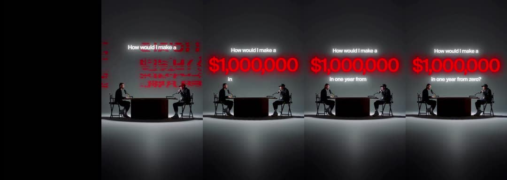

# v04_s01 · hook_banner · 0.0–2.3s (calidad 5)

- **Guion:** How would I make a million dollars in one year from zero?
- **Qué se ve:** Negro 0.25 s; destello rojo; plano general de dos siluetas en una mesa. Texto 'How would I make a' + cifra roja gigante que cuenta hasta '$1,000,000' + 'in one year from zero?'.
- **Diseño:** Plano general: dos siluetas en sillas de director a ambos lados de una mesa, a contraluz, suelo iluminado en blanco en la mitad inferior. Texto centrado: 'How would I make a' en sans blanca pequeña con halo (y≈28 %), debajo la cifra '$1,000,000' en sans bold ROJA muy grande (≈7 % del alto, ancho ≈88 %) con glow rojo (y≈36 %), y 'in one year from zero?' en sans blanca pequeña (y≈44 %).
- **Efectos:** Glow rojo fuerte en la cifra; halo blanco en el texto; contraluz y viñeta; imagen casi monocroma.
- **Animación:** 0.00–0.25 negro; 0.25–0.42 destello rojo/naranja con una banda negra que barre (4–5 fotogramas); luego la cifra CUENTA hacia arriba (a 0.5 s '$590,145', a 1.0 s '$1,000,000') y la última línea se escribe palabra a palabra.
- **Por qué aquí:** La pregunta del entrevistador se convierte en titular con la cifra como imagen principal.
