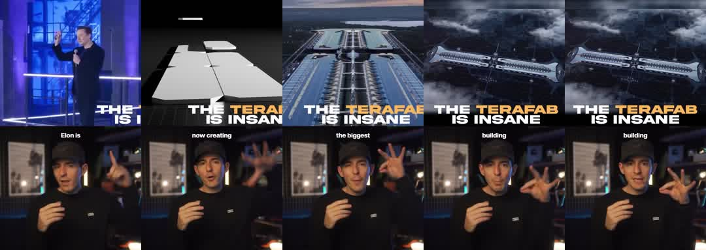

# v05_s01 · hook_banner · 0.0–2.5s (calidad 5)

- **Guion:** Elon is now creating the biggest building in
- **Qué se ve:** Pantalla dividida. Arriba, 4 clips en 2,5 s: Elon en un escenario azul (0–0.27), render 3D de bloques blancos sobre retícula negra (0.27–1.13), render aéreo del TeraFab al atardecer (1.13–1.79) y vista cenital nocturna entre nubes (1.79–2.50). Sobre la costura, el título «THE TERAFAB IS INSANE». Abajo él a cámara, gesticulando con la mano abierta.
- **Diseño:** Título en 2 líneas, MAYÚSCULAS, sans extendida muy pesada (tipo Monument Extended / Druk Wide), blanco con «TERAFAB» en naranja claro (#F5A94A aprox.), ~56 px de alto de letra sobre 720, alineado al centro, apoyado justo encima de la costura (y≈42–50 %). NO hay franja roja: es texto suelto con sombra oscura. Subtítulo blanco sans bold (tipo Inter/Helvetica Now), minúsculas con mayúscula inicial, 1–3 palabras, ~28 px sobre 720 (≈2,2 % del alto), centrado en x, y≈54 % (justo bajo la costura, que está en y≈50,4 %); sin caja sobre el A-roll oscuro
- **Efectos:** Sombra/degradado negro bajo el título para separarlo del render; Set oscuro con luces prácticas cian y ámbar desenfocadas; sin textura añadida visible
- **Animación:** El título entra con slide desde la derecha (a 0.00 ya asoma «THE TE…», a 0.50 sigue cortado por la derecha, centrado en ≈1.0 s) y se queda quieto hasta 2.50; los clips de arriba cambian por corte seco; subtítulo cambia por corte cada 1–2 palabras
- **Por qué aquí:** Hook: nombra a Elon y el superlativo («biggest building») mientras el título promete el juicio («is insane»); 4 imágenes en 2,5 s dan prueba inmediata de que hay material real
