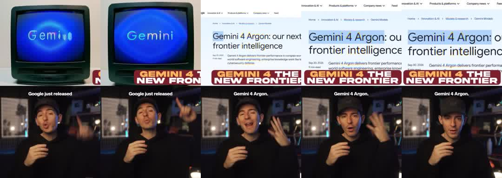

# v06_s01 · hook_banner · 0.0–2.6s (calidad 5)

- **Guion:** Google just released Gemini for Argonne.
- **Qué se ve:** Pantalla dividida. Arriba: un televisor CRT antiguo cuya pantalla azul forma la palabra «Gemini» (0–0.87); glitch digital (0.87–1.07); página del blog de Google «Gemini 4 Argon: our next era of frontier intelligence» con «Gemini 4 Argon» resaltado en azul claro (1.07–2.60). Sobre la costura, franja roja «GEMINI 4 THE NEW FRONTIER». Abajo él a cámara.
- **Diseño:** Franja: rectángulo rojo oscuro (#8C1C1C aprox.) con esquinas redondeadas y borde claro fino, 2 líneas en MAYÚSCULAS sans extendida ultra pesada: «GEMINI 4» en naranja-amarillo (#F5A623 aprox.) y «THE NEW FRONTIER» en crema; ocupa ≈95 % del ancho, apoyada sobre la costura (y≈39–48 %), desbordando por la derecha. Subtítulo blanco sans bold (tipo Inter), 1–3 palabras, ~30 px sobre 720 (≈2,3 % del alto), centrado, y≈52,7 % (≈58 px bajo la costura, que está en y≈48,1 %); sin caja
- **Efectos:** Aberración cromática/glitch RGB sobre la captura del blog (bordes de letras con franjas de color); Set oscuro con luces cian y ámbar desenfocadas; sin textura añadida
- **Animación:** La franja entra con slide desde la derecha (asoma a 0.13, colocada a ≈0.9) y se queda hasta 2.60; glitch de 3 fotogramas entre el TV y el blog (0.87–1.07); zoom-in lento en la captura
- **Por qué aquí:** Hook de noticia: «Google just released» + prueba (blog oficial) + etiqueta roja que resume la promesa. El TV retro da un primer fotograma raro que frena el scroll
