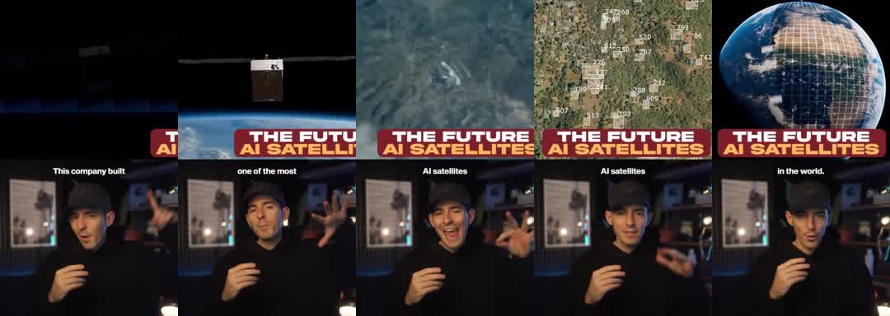

# v07_s01 · hook_banner · 0.0–3.6s (calidad 5)

- **Guion:** This company built one of the most advanced AI satellites in the world.
- **Qué se ve:** Pantalla dividida. Arriba, 4 planos: satélite pequeño sobre el horizonte terrestre que emerge de negro (0–1.13), la Tierra desde la órbita con franjas de imágenes (1.13–1.67), zoom a través de nubes hasta un terreno con edificios numerados (1.67–2.84) y globo con retícula (2.84–3.59). Sobre la costura, franja roja «THE FUTURE / AI SATELLITES». Abajo él a cámara.
- **Diseño:** Franja: rectángulo rojo oscuro (#8B1A1A aprox.) de esquinas redondeadas con borde fino claro; 2 líneas MAYÚSCULAS en sans extendida ultra pesada: «THE FUTURE» blanco, «AI SATELLITES» amarillo-naranja (#F5B301 aprox.); apoyada sobre la costura (y≈41–50 %), borde izquierdo en x≈11 % y desbordando por la derecha. Subtítulo blanco sans bold (tipo Inter), 1–3 palabras, ~28 px sobre 720, centrado, y≈54 % (≈48 px bajo la costura, que está en y≈50,4 %); sin caja sobre el A-roll
- **Efectos:** Fundido de entrada desde azul/negro en la mitad superior (0–0.3); Set oscuro con luces cian y ámbar desenfocadas; sin textura añadida
- **Animación:** La franja entra con slide desde la derecha (asoma a 0.27, colocada a ≈1.0) y se va por corte a 3.59; arriba cortes secos a 1.13, 1.67 (con zoom continuo) y 2.84
- **Por qué aquí:** Hook de curiosidad («This company built one of the most advanced AI satellites») + 4 pruebas visuales + etiqueta roja que nombra el tema
