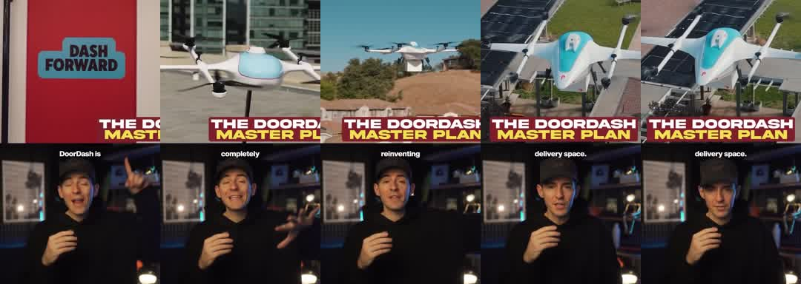

# v08_s01 · hook_banner · 0.0–3.4s (calidad 5)

- **Guion:** DoorDash is completely reinventing the food delivery space.
- **Qué se ve:** Pantalla dividida. Arriba, 4 planos: cartel rojo «DASH FORWARD» con zoom (0–0.54), dron blanco en un soporte frente a un edificio (0.54–1.08), dron volando sobre colinas y casas (1.08–1.96) y dron turquesa/blanco sobre tejados (1.96–3.42). Sobre la costura, franja roja «THE DOORDASH / MASTER PLAN». Abajo él a cámara.
- **Diseño:** Franja: rectángulo rojo oscuro (#8B1A1A aprox.) de esquinas redondeadas con borde claro fino; 2 líneas MAYÚSCULAS en sans extendida ultra pesada: «THE DOORDASH» blanco, «MASTER PLAN» amarillo (#F7D21E aprox.); apoyada sobre la costura (y≈41–50 %), desde x≈13 % y desbordando por la derecha. Subtítulo blanco sans bold (tipo Inter), 1–3 palabras, ~28 px sobre 720, centrado, y≈54 % (≈48 px bajo la costura, que está en y≈50,4 %); sin caja
- **Efectos:** Set oscuro con luces cian y ámbar desenfocadas; sin textura añadida
- **Animación:** La franja entra con slide desde la derecha (visible desde 0.0, colocada a ≈1.0) y se va por corte a 3.42; zoom-in de ~4 fotogramas al cartel en el primer plano
- **Por qué aquí:** Hook: marca conocida + verbo fuerte («completely reinventing») + el dron como prueba inmediata; la franja promete un «master plan»
