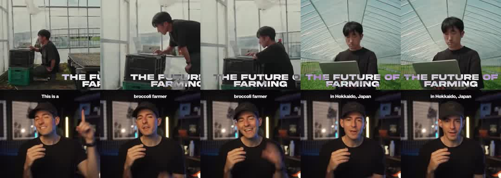

# v09_s01 · hook_banner · 0.0–2.6s (calidad 4)

- **Guion:** This is a broccoli farmer in Hokkaido, Japan, and
- **Qué se ve:** Arriba, 3 clips de Hiroki en su invernadero con portátil; título 'THE FUTURE OF FARMING' entrando desde la derecha sobre la costura; abajo Kallaway a cámara con subtítulo 'This is a / broccoli farmer / in Hokkaido, Japan'.
- **Diseño:** Franja SIN caja roja (excepción): título 'THE FUTURE OF / FARMING' en sans extendida ultra-bold MAYÚSCULAS, 2 líneas, relleno blanco con degradado lila (≈#B9A3FF) en 'THE FUTURE OF', sobre el borde inferior de la mitad superior (y≈40–49 %); queda desplazado a la derecha con 'OF' cortado por el borde (1.6 s). Split 50/50 (costura y≈50.4 %). Subtítulo: sans geométrica bold blanca, minúsculas con puntuación, ≈30 px de alto de letra sobre 720 px de ancho, centrado en x, 1–3 palabras, ≈40–45 px bajo la costura.
- **Efectos:** Sin grano, papel ni halftone añadidos. A-roll: set oscuro, viñeta natural, prácticos cálidos y tubo/luz cian al fondo. Franja con color plano, sin textura; arriba el material va sin grado aparente.
- **Animación:** La franja entra deslizándose desde la derecha (≈0.8–1.5 s, ease-out) mientras arriba se suceden clips por corte seco; se va por corte seco al terminar la primera frase. Subtítulo: cambia por sustitución instantánea (sin fade apreciable a 15 fps).
- **Por qué aquí:** Hook: presenta al personaje (un agricultor, no una empresa) con imagen real desde el fotograma 0 y un título que promete el tema; la cara de Kallaway da la confianza.
