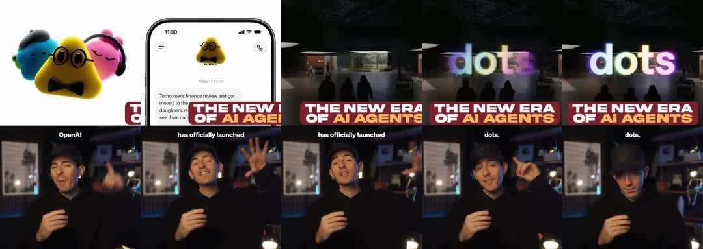

# v10_s01 · hook_banner · 0.0–2.2s (calidad 5)

- **Guion:** OpenAI has officially launched Dots. And
- **Qué se ve:** Arriba: mascotas 3D de 'dots' (blobs de colores → triángulo amarillo con gafas y pajarita), móvil con chat de 'Alfred' y logo 'dots' arcoíris luminoso en un plató oscuro; franja roja 'THE NEW ERA OF AI AGENTS' entrando desde la derecha; abajo él: 'OpenAI / has officially launched / dots.'
- **Diseño:** Franja: caja rojo oscuro (≈#8E1B22) de esquinas redondeadas, 2 líneas en sans extendida ultra-bold MAYÚSCULAS: 'THE NEW ERA' blanca / 'OF' blanca + 'AI AGENTS' naranja-dorado (≈#F5A623); ≈93 % del ancho, y≈40–50 % (apoyada sobre la costura). Split 50/50 (costura y≈50.4 %). Subtítulo: sans geométrica bold blanca, minúsculas con puntuación, ≈30 px de alto de letra sobre 720 px de ancho, centrado en x, 1–3 palabras, ≈40–45 px bajo la costura.
- **Efectos:** Sin grano, papel ni halftone añadidos. A-roll: set oscuro, viñeta natural, prácticos cálidos y tubo/luz cian al fondo. Franja con color plano, sin textura; arriba el material va sin grado aparente.
- **Animación:** La franja entra deslizándose desde la derecha (≈0.8–1.5 s, ease-out) mientras arriba se suceden clips por corte seco; se va por corte seco al terminar la primera frase. Subtítulo: cambia por sustitución instantánea (sin fade apreciable a 15 fps).
- **Por qué aquí:** Hook de lanzamiento: marca + producto + logo en 2.2 s y una franja que eleva la noticia a 'nueva era'.
