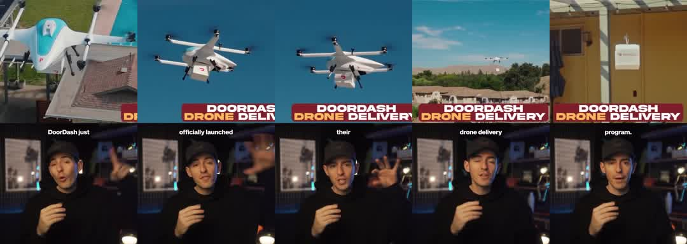

# v11_s01 · hook_banner · 0.0–3.2s (calidad 4)

- **Guion:** DoorDash just officially launched their drone delivery program.
- **Qué se ve:** Arriba 4 clips del dron de DoorDash (aéreo sobre casas, dron con paquete en cielo azul, dron lejano sobre árboles, paquete bajando junto a una casa); franja roja 'DOORDASH DRONE DELIVERY' entrando desde la derecha; abajo él: 'DoorDash just / officially launched / their / drone delivery / program.'
- **Diseño:** Franja: caja rojo oscuro (≈#8E1B22) de esquinas redondeadas, 2 líneas en sans extendida ultra-bold MAYÚSCULAS: 'DOORDASH' blanca / 'DRONE' naranja-dorado (≈#F5A623) + 'DELIVERY' blanca; ≈88 % del ancho desde x≈12 % hasta el borde derecho, y≈42–50 % (apoyada sobre la costura). Split 50/50 (costura y≈50.4 %). Subtítulo: sans geométrica bold blanca, minúsculas con puntuación, ≈30 px de alto de letra sobre 720 px de ancho, centrado en x, 1–3 palabras, ≈40–45 px bajo la costura.
- **Efectos:** Sin grano, papel ni halftone añadidos. A-roll: set oscuro, viñeta natural, prácticos cálidos y tubo/luz cian al fondo. Franja con color plano, sin textura; arriba el material va sin grado aparente.
- **Animación:** La franja entra deslizándose desde la derecha (≈0.8–1.5 s, ease-out) mientras arriba se suceden clips por corte seco; se va por corte seco al terminar la primera frase. Subtítulo: cambia por sustitución instantánea (sin fade apreciable a 15 fps).
- **Por qué aquí:** Hook de noticia: el objeto (dron) en 4 ángulos en 3.2 s + franja que titula; cada corte cae en una palabra fuerte (officially, drone, program).
