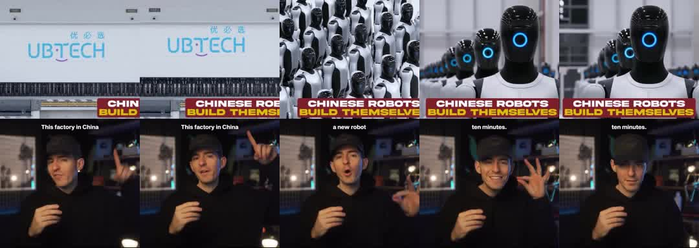

# v12_s01 · hook_banner · 0.0–3.8s (calidad 5)

- **Guion:** This factory in China is building a new robot every 10 minutes.
- **Qué se ve:** Arriba 3 planos de la fábrica UBTECH (rótulo UBTECH con filas de robots, multitud de robots, robots en fila con cara de anillo azul); franja roja 'CHINESE ROBOTS BUILD THEMSELVES'; abajo él: 'This factory in China / is building / a new robot / every / ten minutes.'
- **Diseño:** Franja: caja rojo oscuro (≈#8E1B22) de esquinas redondeadas, 2 líneas en sans extendida ultra-bold MAYÚSCULAS: 'CHINESE ROBOTS' blanca / 'BUILD THEMSELVES' amarillo-dorado (≈#F7B500); ≈95 % del ancho, y≈39–47 % (apoyada sobre la costura). Split 48/52 (costura y≈47.7 %). Subtítulo: sans geométrica bold blanca, minúsculas con puntuación, ≈30 px de alto de letra sobre 720 px de ancho, centrado en x, 1–3 palabras, ≈40–45 px bajo la costura.
- **Efectos:** Sin grano, papel ni halftone añadidos. A-roll: set oscuro, viñeta natural, prácticos cálidos y tubo/luz cian al fondo. Franja con color plano, sin textura; arriba el material va sin grado aparente.
- **Animación:** La franja entra deslizándose desde la derecha (≈0.8–1.5 s, ease-out) mientras arriba se suceden clips por corte seco; se va por corte seco al terminar la primera frase. Subtítulo: cambia por sustitución instantánea (sin fade apreciable a 15 fps).
- **Por qué aquí:** Hook de dato imposible ('a new robot every 10 minutes') + imagen masiva de robots; la franja reformula la tesis en 4 palabras.
