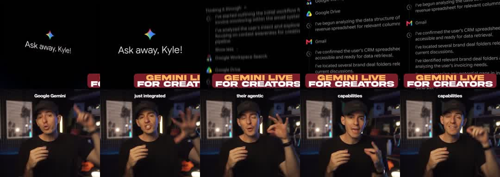

# v13_s01 · hook_banner · 0.0–3.3s (calidad 5)

- **Guion:** Google Gemini just integrated their agentic capabilities in
- **Qué se ve:** Arranque en split: arriba la pantalla de inicio de Gemini Live («Ask away, Kyle!» con la chispa de 4 puntas multicolor sobre negro) y desde ~1,4 s un registro de acciones del agente (Google Workspace Search, Google Drive, Gmail, «I've begun analyzing the data structure of the revenue spreadsheet…»). Franja roja «GEMINI LIVE / FOR CREATORS» sobre la costura. Abajo él gesticulando con la mano abierta.
- **Diseño:** Pantalla dividida: evidencia arriba (0–50 %), él abajo en set oscuro (gorra y camiseta negras, luces naranja/cian desenfocadas). Costura recta sin borde en y≈645 px de 1280 (50,4 %). Subtítulo: sans geométrica bold blanca (tipo Inter/Helvetica Now Bold), minúsculas con mayúscula inicial de frase, ~30 px de alto de fuente sobre 720 px de ancho, 1–3 palabras, centrado en x, sombra negra suave. Subtítulo en y≈693 px (54 %), justo bajo la costura, sobre su gorra. Franja del gancho: rectángulo rojo oscuro (~#A01E28) de esquinas redondeadas, y≈535–634 px (alto ~100 px, 7,7 % del alto), pisa la costura por arriba; 2 líneas en sans EXTENDIDA ultra-bold mayúsculas (tipo Monument Extended): línea 1 degradado naranja→amarillo (~#F39A2B→#FFD24A), línea 2 blanca.
- **Efectos:** Sin grano ni viñeta añadidos; la franja lleva sombra suave. Fondo del set con bokeh natural.
- **Animación:** La franja entra deslizándose desde la derecha (0,1→1,3 s, desacelerando) y se queda fija hasta 3,34 s; desaparece por corte seco. Subtítulo cambia por corte cada 0,3–0,6 s.
- **Por qué aquí:** Gancho: nombra la novedad (franja = promesa «para creadores») mientras arriba ya se ve el producto funcionando; anuncia con la cara abajo y prueba arriba.
