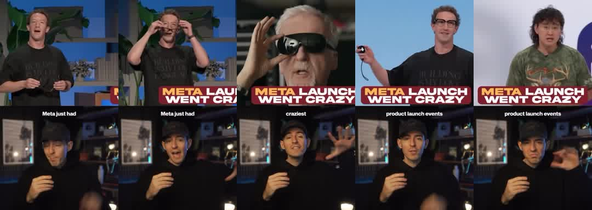

# v14_s01 · hook_banner · 0.0–3.1s (calidad 5)

- **Guion:** Meta just had one of the craziest product launch events I've
- **Qué se ve:** Split con franja roja «META LAUNCH / WENT CRAZY». Arriba 4 clips del evento por corte: presentador con camiseta «BUILDING IS MY LOVE LANGUAGE» poniéndose unas gafas (0–1,29 s), hombre de barba blanca sosteniendo un visor oscuro envolvente (1,29–1,88), el presentador sobre fondo azul cielo con un dispositivo redondo con cordón (1,88–2,58), joven con camiseta de camuflaje (2,58–3,12). Abajo él con la mano abierta.
- **Diseño:** Pantalla dividida: evidencia arriba, él abajo en set oscuro (gorra y sudadera con capucha negras, bokeh cálido y cian). Costura recta sin borde en y=646 px de 1280 (50,5 %). Subtítulo: sans bold blanca (tipo Inter/Helvetica Now Bold) ~30 px de alto de fuente sobre 720 px de ancho, 1–3 palabras, centrado en x, sombra negra suave. Subtítulo en y≈693 px (54 %), justo bajo la costura. Franja del gancho: rectángulo rojo oscuro (~#9E1B24) de esquinas redondeadas, y≈527–639 px (alto ~112 px, 8,7 %), apoyada sobre la costura; x desde ~40 px hasta salir por la derecha. 2 líneas en sans EXTENDIDA ultra-bold mayúsculas (tipo Monument Extended): «META» naranja-amarillo (~#F5A22B) + «LAUNCH» blanco / «WENT CRAZY» blanco.
- **Efectos:** Sombra suave de la franja; sin grano.
- **Animación:** Franja entra por slide desde la derecha (0,3→1,0 s) y queda fija hasta 3,12 s; sale por corte seco. Arriba, montaje de clips por corte cada 0,5–0,7 s.
- **Por qué aquí:** Gancho de noticia: 4 imágenes distintas en 3 s prometen «muchas cosas pasaron»; la franja da el titular.
