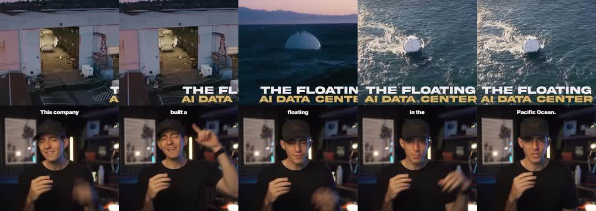

# v16_s01 · hook_banner · 0.0–3.3s (calidad 5)

- **Guion:** This company built a data center floating in the Pacific Ocean.
- **Qué se ve:** Split con título «THE FLOATING / AI DATA CENTER» sobre la costura. Arriba 4 clips: nave industrial con una gran esfera dentro (0–0,93), interior blanco de la esfera con escotilla (0,93–1,57), cúpula blanca flotando al atardecer (1,57–2,23), vista de dron de la boya blanca dejando estela (2,23–3,27). Abajo él señalando hacia arriba.
- **Diseño:** Pantalla dividida: evidencia arriba, él abajo en set oscuro (gorra y camiseta negras, tubo de luz cálida a la derecha, luz cian a la izquierda). Costura recta sin borde en y≈639 px de 1280 (49,9 %). Subtítulo: sans bold blanca (tipo Inter/Helvetica Now Bold) ~30 px de alto de fuente sobre 720 px de ancho, 1–3 palabras, centrado en x, sombra negra suave. Subtítulo en y≈680 px (53 %), justo bajo la costura. Título del gancho SIN caja: 2 líneas de sans EXTENDIDA ultra-bold mayúsculas directamente sobre el video con sombra oscura, y≈520–630 px, apoyadas sobre la costura: «THE FLOATING» blanco / «AI DATA CENTER» dorado (~#D9B45A).
- **Efectos:** Sombra negra difusa bajo el título; sin grano.
- **Animación:** Título entra por slide desde la derecha (0→~1,5 s) y queda fijo hasta 3,27 s; debajo, 4 clips por corte. Sale por corte seco.
- **Por qué aquí:** Gancho visual: el objeto raro (una esfera blanca en el océano) se ve antes de entenderlo; el título dice qué es.
