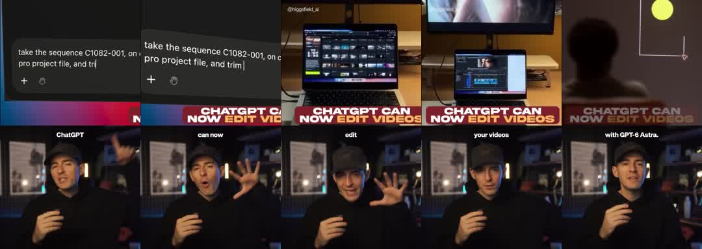

# v17_s01 · hook_banner · 0.0–3.2s (calidad 5)

- **Guion:** ChatGPT can now automatically edit your videos with GPT-6
- **Qué se ve:** Split 50/50. Arriba, 4 planos en 3.2 s: caja de prompt con texto escribiéndose «take the sequence C1082-001, on pro project file, and trim», timeline con clips azules/verdes, portátil sobre soporte con DaVinci Resolve abierto bajo un monitor, y silueta oscura con círculo amarillo y trazado. Franja roja «CHATGPT CAN / NOW EDIT VIDEOS» sobre la costura. Abajo él gesticulando; subtítulos «ChatGPT / can now / automatically / edit / your videos».
- **Diseño:** Pantalla dividida (costura en y≈50.3% del alto). Franja del gancho apoyada sobre la costura, pegada al borde derecho y ocupando ~95 % del ancho y ~7 % del alto (y≈548–642 px de 1280): caja rojo oscuro ≈#84272A con filo claro fino, dos líneas en sans extendida ultra-black MAYÚSCULAS (tipo Monument Extended/Druk Wide): línea 1 blanca, línea 2 naranja-dorado ≈#FDB75A. Subtítulo pequeño: sans geométrica bold (tipo Aeonik/Satoshi bold), blanco #FFFFFF, minúsculas tipo frase, ≈30 px de cuerpo sobre 720 px de ancho (bloque de 22 px de alto), centrado en X, 1–3 palabras por bloque, justo bajo la costura (centro y≈54 %).
- **Efectos:** Sin texturas añadidas; set oscuro con luces cálidas y teal al fondo; ligera sombra bajo el subtítulo. Sin grano visible.
- **Animación:** La franja entra deslizándose desde la derecha (slide horizontal con desaceleración, ~0.8–1.2 s hasta quedar completa) y se queda fija hasta el corte; arriba el material cambia por cortes secos cada ~0.7–1 s; subtítulo cambia por pop seco (sin fade). Franja: asoma en 0.13 s, «CHATGPT C / NOW EDIT VI» a 0.5 s, completa ≈1.2–1.5 s.
- **Por qué aquí:** Gancho: en 3 s enseña la promesa literal (un prompt que edita) + el titular en franja roja para quien ve sin sonido. Cuatro pruebas visuales distintas antes de que termine la primera frase.
