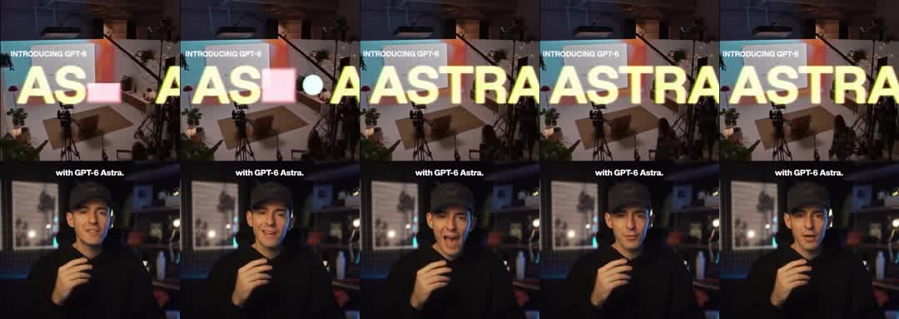

# v17_s02 · hook_banner · 3.2–4.2s (calidad 3)

- **Guion:** Astra.
- **Qué se ve:** Sigue la franja roja; arriba aparece el logo «INTRODUCING GPT-6 / ASTRA» (letras amarillo crema con brillo sobre foto cálida de un estudio con cámara y trípode). Subtítulo «with GPT-6 Astra.»
- **Diseño:** Pantalla dividida (costura en y≈50.3% del alto). Franja del gancho apoyada sobre la costura, pegada al borde derecho y ocupando ~95 % del ancho y ~7 % del alto (y≈548–642 px de 1280): caja rojo oscuro ≈#84272A con filo claro fino, dos líneas en sans extendida ultra-black MAYÚSCULAS (tipo Monument Extended/Druk Wide): línea 1 blanca, línea 2 naranja-dorado ≈#FDB75A. Subtítulo pequeño: sans geométrica bold (tipo Aeonik/Satoshi bold), blanco #FFFFFF, minúsculas tipo frase, ≈30 px de cuerpo sobre 720 px de ancho (bloque de 22 px de alto), centrado en X, 1–3 palabras por bloque, justo bajo la costura (centro y≈54 %).
- **Efectos:** Sin texturas añadidas; set oscuro con luces cálidas y teal al fondo; ligera sombra bajo el subtítulo. Sin grano visible.
- **Animación:** La franja entra deslizándose desde la derecha (slide horizontal con desaceleración, ~0.8–1.2 s hasta quedar completa) y se queda fija hasta el corte; arriba el material cambia por cortes secos cada ~0.7–1 s; subtítulo cambia por pop seco (sin fade).
- **Por qué aquí:** Al nombrar el modelo muestra su logo: «nombre propio → logo» para dar autoridad/novedad dentro del gancho.
