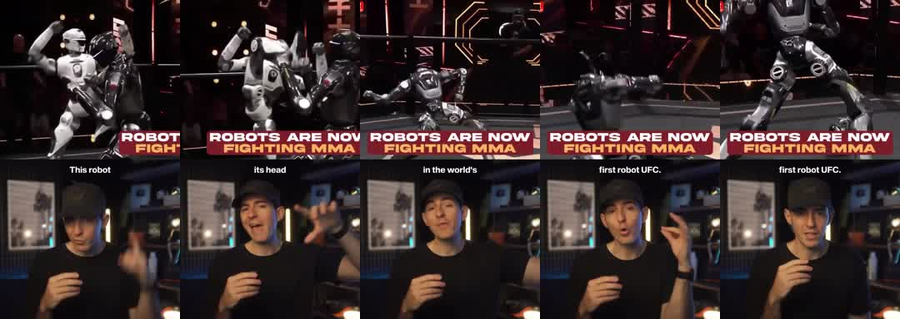

# v18_s01 · hook_banner · 0.0–4.3s (calidad 5)

- **Guion:** This robot just got its head kicked off in the world's first robot UFC.
- **Qué se ve:** Split 50/50. Arriba pelea de robots humanoides en una jaula con luces rojas: un robot blanco patea a uno negro; a los 2.1 s otro ángulo con el robot cayendo. Franja roja «ROBOTS ARE NOW / FIGHTING MMA» sobre la costura. Abajo él (camiseta negra, gorra) gesticulando; subtítulos «This robot / its head / kicked off / in the world's / first robot UFC.»
- **Diseño:** Pantalla dividida (costura en y≈49.8% del alto). Franja del gancho apoyada sobre la costura, pegada al borde derecho y ocupando ~95 % del ancho y ~7 % del alto (y≈548–642 px de 1280): caja rojo oscuro ≈#84272A con filo claro fino, dos líneas en sans extendida ultra-black MAYÚSCULAS (tipo Monument Extended/Druk Wide): línea 1 blanca, línea 2 naranja-dorado ≈#FDB75A. Subtítulo pequeño: sans geométrica bold (tipo Aeonik/Satoshi bold), blanco #FFFFFF, minúsculas tipo frase, ≈30 px de cuerpo sobre 720 px de ancho (bloque de 22 px de alto), centrado en X, 1–3 palabras por bloque, justo bajo la costura (centro y≈54 %).
- **Efectos:** Sin texturas añadidas; set oscuro con luces cálidas y teal al fondo; ligera sombra bajo el subtítulo. Sin grano visible.
- **Animación:** La franja entra deslizándose desde la derecha (slide horizontal con desaceleración, ~0.8–1.2 s hasta quedar completa) y se queda fija hasta el corte; arriba el material cambia por cortes secos cada ~0.7–1 s; subtítulo cambia por pop seco (sin fade). Franja: asoma en 0.13 s, «ROBOTS ARE N / FIGHT» a 0.5 s, completa ≈1.0 s; fija hasta 4.34.
- **Por qué aquí:** Gancho con la imagen más violenta/insólita (cabeza de robot pateada) desde el fotograma 0 + titular en franja para ver sin sonido.
