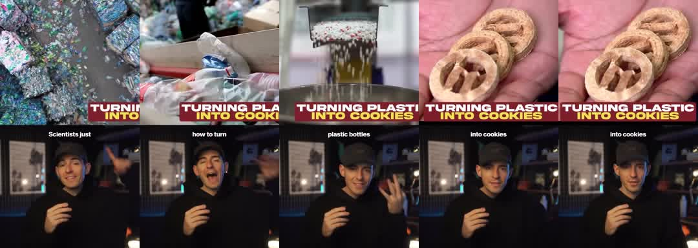

# v19_s01 · hook_banner · 0.0–3.9s (calidad 5)

- **Guion:** Scientists just figured out how to turn plastic bottles into cookies.
- **Qué se ve:** Split 50/50. Arriba 4 planos: vista aérea de fardos de plástico prensado, cinta con botellas, tolva soltando granza blanca/roja, y una mano con tres galletas en forma de «μ» dentro de un aro. Franja roja «TURNING PLASTIC / INTO COOKIES» sobre la costura. Abajo él (sudadera negra, gorra); subtítulos «Scientists just / figured out / how to turn / plastic bottles / into cookies».
- **Diseño:** Pantalla dividida (costura en y≈50.3% del alto). Franja del gancho apoyada sobre la costura, pegada al borde derecho y ocupando ~95 % del ancho y ~7 % del alto (y≈548–642 px de 1280): caja rojo oscuro ≈#84272A con filo claro fino, dos líneas en sans extendida ultra-black MAYÚSCULAS (tipo Monument Extended/Druk Wide): línea 1 blanca, línea 2 naranja-dorado ≈#FDB75A. Subtítulo pequeño: sans geométrica bold (tipo Aeonik/Satoshi bold), blanco #FFFFFF, minúsculas tipo frase, ≈30 px de cuerpo sobre 720 px de ancho (bloque de 22 px de alto), centrado en X, 1–3 palabras por bloque, justo bajo la costura (centro y≈54 %).
- **Efectos:** Sin texturas añadidas; set oscuro con luces cálidas y teal al fondo; ligera sombra bajo el subtítulo. Sin grano visible.
- **Animación:** La franja entra deslizándose desde la derecha (slide horizontal con desaceleración, ~0.8–1.2 s hasta quedar completa) y se queda fija hasta el corte; arriba el material cambia por cortes secos cada ~0.7–1 s; subtítulo cambia por pop seco (sin fade). Franja: «TUR / IN» a 0.1 s, «TURNING PL / INTO COO» a 0.5 s, completa ≈2.5–3.0 s (entra más lento que en otros videos, sigue deslizándose mientras habla).
- **Por qué aquí:** Gancho como mini-proceso en 4 planos: basura → triturado → galleta, exactamente en el orden de la frase («plastic bottles» → «into cookies»). El resultado (galleta) llega con la última palabra.
