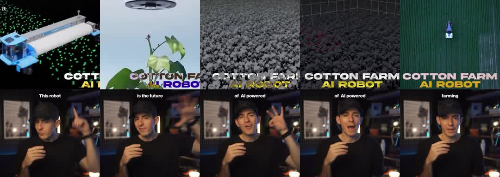

# v20_s01 · hook_banner · 0.0–3.0s (calidad 5)

- **Guion:** This robot is the future of AI-powered farming. And
- **Qué se ve:** Split 50/50. Arriba 4 planos del video promocional: máquina azul y blanca en render 3D sobre negro con puntos verdes, planta de algodón con un disco blanco encima, campo 3D oscuro con rejilla y puntos rojos, y vista aérea de la máquina en un campo verde. Rótulo del gancho «COTTON FARM / AI ROBOT» SIN caja roja (blanco + amarillo) sobre la costura. Abajo él (camiseta negra, gorra); subtítulos «This robot / is the future / of AI powered / farming».
- **Diseño:** Pantalla dividida (costura en y≈50.3 %). Rótulo del gancho de dos líneas apoyado sobre la costura SIN caja de color: sans extendida ultra-black MAYÚSCULAS con aspecto metalizado/biselado, línea 1 «COTTON FARM» blanca-plateada, línea 2 «AI ROBOT» amarilla ≈#CFBD2D, ≈7 % del alto. Subtítulo pequeño blanco bold ≈30 px bajo la costura (centro y≈54 %).
- **Efectos:** Sin texturas añadidas; set oscuro con luces cálidas y teal al fondo; ligera sombra bajo el subtítulo. Sin grano visible.
- **Animación:** La franja entra deslizándose desde la derecha (slide horizontal con desaceleración, ~0.8–1.2 s hasta quedar completa) y se queda fija hasta el corte; arriba el material cambia por cortes secos cada ~0.7–1 s; subtítulo cambia por pop seco (sin fade). Rótulo: «C / A» a 0.0 s, «COTTON F / AI ROBO» a 0.5 s, completo ≈1.5 s; en 0.83–1.3 se ve con aberración cromática/desenfoque morado al pasar sobre el plano claro; fijo hasta 3.04.
- **Por qué aquí:** Gancho: «This robot» → la máquina en el primer fotograma; 4 planos en 3 s y titular de 4 palabras para el que mira sin sonido.
