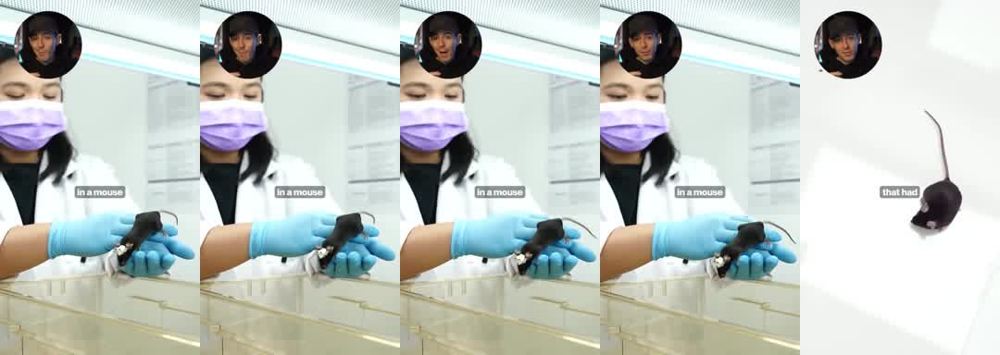

# v01_s11 · pip_broll · 11.2–11.6s (calidad 4)

- **Guion:** a mouse that
- **Qué se ve:** Persona con mascarilla lila y guantes azules sujetando un ratón negro. Subtítulo 'in a mouse'.
- **Diseño:** B-roll o captura a PANTALLA COMPLETA (100 %). Su cara en un círculo arriba a la izquierda: diámetro ≈33 % del ancho (≈240 px), centro en x≈24 %, y≈12 %, sin borde visible. Subtítulo pequeño blanco sans bold de 1–3 palabras en el centro (y≈54 %) dentro de una pastilla gris semitransparente de esquinas redondeadas cuando el fondo es claro; sobre fondo oscuro va sin pastilla.
- **Efectos:** Sin texturas añadidas; el material conserva su color original.
- **Animación:** Corte seco de entrada y salida. El círculo aparece ya colocado (sin animación visible). El material de fondo se mueve por sí mismo (video real o animación de interfaz).
- **Por qué aquí:** Muestra el ratón en la palabra 'mouse'.
