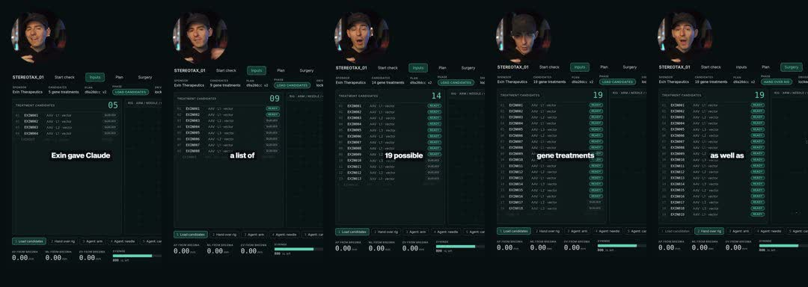

# v01_s16 · pip_broll · 17.6–20.9s (calidad 5)

- **Guion:** Exyn gave Claude a list of 19 possible gene treatments, as well as
- **Qué se ve:** Interfaz a pantalla completa: pestañas Start check/Inputs/Plan/Surgery, lista 'TREATMENT CANDIDATES' que crece fila a fila con contador 04→19 y etiquetas READY/QUEUED; su cara en círculo. Subtítulo 'Exin gave Claude' / 'a list of' / '19 possible' / 'gene treatments'.
- **Diseño:** B-roll o captura a PANTALLA COMPLETA (100 %). Su cara en un círculo arriba a la izquierda: diámetro ≈33 % del ancho (≈240 px), centro en x≈24 %, y≈12 %, sin borde visible. Subtítulo pequeño blanco sans bold de 1–3 palabras en el centro (y≈54 %) dentro de una pastilla gris semitransparente de esquinas redondeadas cuando el fondo es claro; sobre fondo oscuro va sin pastilla.
- **Efectos:** Sin texturas añadidas; el material conserva su color original.
- **Animación:** Corte seco de entrada y salida. El círculo aparece ya colocado (sin animación visible). El material de fondo se mueve por sí mismo (video real o animación de interfaz).
- **Por qué aquí:** El dato '19 tratamientos' se ve contado en pantalla mientras lo dice.
