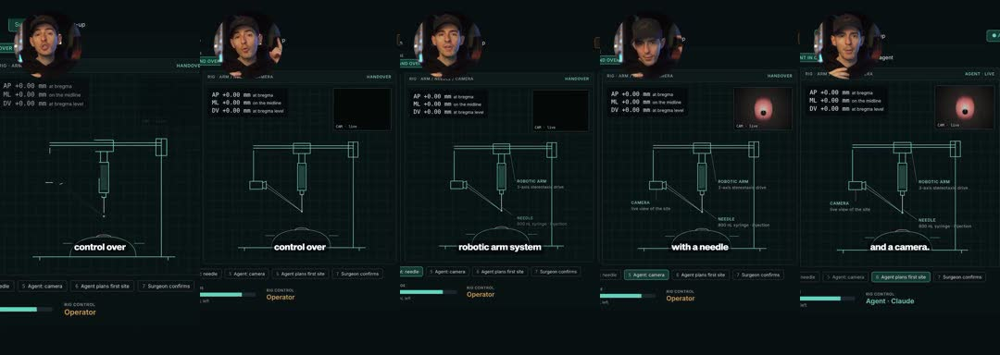

# v01_s17 · pip_broll · 20.9–24.4s (calidad 5)

- **Guion:** control over robotic arm system with a needle and a camera.
- **Qué se ve:** Misma interfaz: diagrama lineal del brazo robótico; aparecen rótulos ROBOTIC ARM, NEEDLE y CAMERA y una vista de cámara rosada; el control pasa de 'Operator' a 'Agent · Claude'. Subtítulo 'control over' / 'robotic arm system' / 'with a needle' / 'and a camera.'.
- **Diseño:** B-roll o captura a PANTALLA COMPLETA (100 %). Su cara en un círculo arriba a la izquierda: diámetro ≈33 % del ancho (≈240 px), centro en x≈24 %, y≈12 %, sin borde visible. Subtítulo pequeño blanco sans bold de 1–3 palabras en el centro (y≈54 %) dentro de una pastilla gris semitransparente de esquinas redondeadas cuando el fondo es claro; sobre fondo oscuro va sin pastilla.
- **Efectos:** Sin texturas añadidas; el material conserva su color original.
- **Animación:** Corte seco de entrada y salida. El círculo aparece ya colocado (sin animación visible). El material de fondo se mueve por sí mismo (video real o animación de interfaz).
- **Por qué aquí:** Cada cosa nombrada (brazo, aguja, cámara) se etiqueta en el diagrama cuando la dice.
