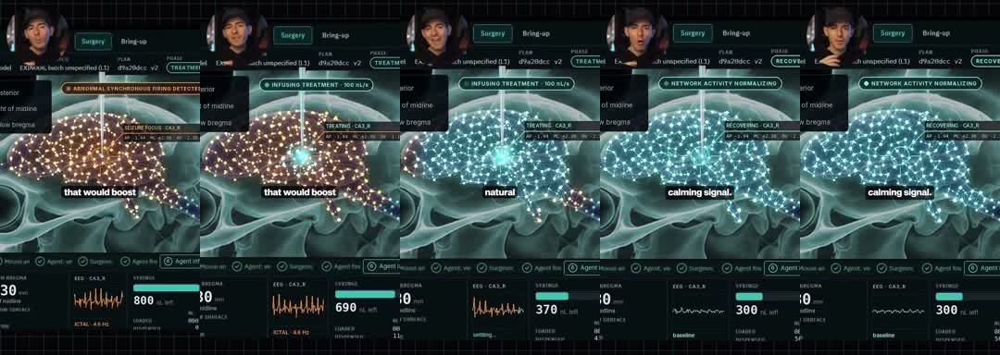

# v01_s23 · pip_broll · 37.8–40.7s (calidad 5)

- **Guion:** would boost the brain's natural calming signal.
- **Qué se ve:** Interfaz a pantalla completa: 'INFUSING TREATMENT · 100 nL/s', los puntos pasan de naranja a cian desde el centro, jeringa baja 800→300 nL, cambia a 'NETWORK ACTIVITY NORMALIZING'. Cara en círculo. Subtítulo 'that would boost' / 'the brain's' / 'natural' / 'calming signal.'.
- **Diseño:** B-roll o captura a PANTALLA COMPLETA (100 %). Su cara en un círculo arriba a la izquierda: diámetro ≈33 % del ancho (≈240 px), centro en x≈24 %, y≈12 %, sin borde visible. Subtítulo pequeño blanco sans bold de 1–3 palabras en el centro (y≈54 %) dentro de una pastilla gris semitransparente de esquinas redondeadas cuando el fondo es claro; sobre fondo oscuro va sin pastilla.
- **Efectos:** Sin texturas añadidas; el material conserva su color original.
- **Animación:** Corte seco de entrada y salida. El círculo aparece ya colocado (sin animación visible). El material de fondo se mueve por sí mismo (video real o animación de interfaz).
- **Por qué aquí:** El 'efecto calmante' se ve como cambio de color; es el clímax visual del video.
