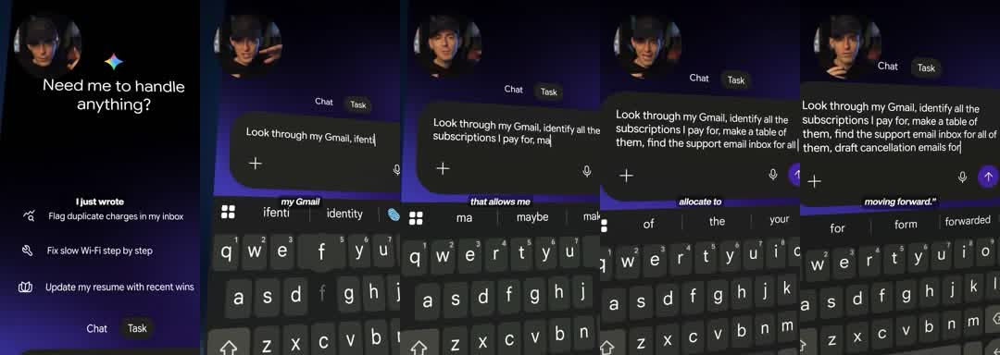

# v02_s15 · pip_broll · 20.9–28.9s (calidad 5)

- **Guion:** I just wrote every six months, go into my Gmail and build a spreadsheet that allows me to decide how much budget I should allocate to my subscriptions moving forward. Just
- **Qué se ve:** Pantalla de móvil a pantalla completa: Gemini 'Need me to handle anything?' con sugerencias; después teclado del teléfono y el prompt escribiéndose ('Look through my Gmail, identify all the subscriptions I pay for, make a table of them, find the support email inbox…'). Su cara en círculo. Subtítulo en cursiva entre comillas ('"Every 6 months', 'go into', 'my Gmail', 'a spreadsheet'…).
- **Diseño:** Grabación de pantalla de móvil a PANTALLA COMPLETA con su cara en círculo arriba a la izquierda (diámetro ≈33 % del ancho). Subtítulo pequeño blanco en CURSIVA sans bold con comillas de apertura, centrado, y≈56 %, justo sobre la fila de sugerencias del teclado.
- **Efectos:** Sin texturas añadidas.
- **Animación:** Corte seco de entrada; el círculo aparece ya colocado. El contenido se anima por sí mismo.
- **Por qué aquí:** El ejemplo completo se ve teclear en tiempo real durante 8 s: es la demostración central.
