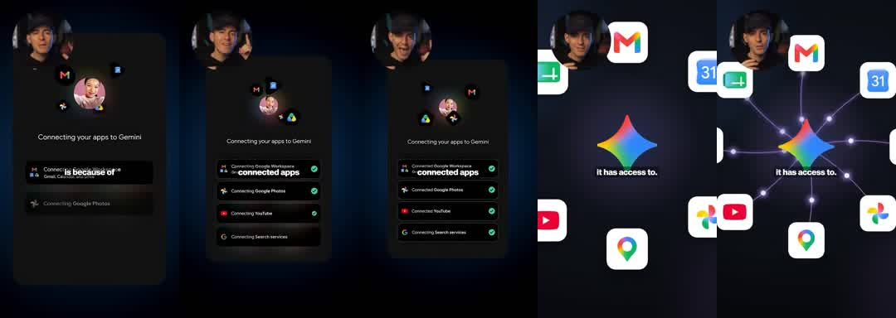

# v02_s24 · pip_broll · 39.3–42.1s (calidad 5)

- **Guion:** because of all the connected apps it has access to.
- **Qué se ve:** Gráfico a pantalla completa: tarjeta 'Connecting your apps to Gemini' con avatar e iconos y una lista (Google Workspace, Google Photos, YouTube, Search services) que se marca en verde; a ~40.9 pasa al destello de Gemini rodeado de iconos (Gmail, Calendar, YouTube, Maps, Photos) unidos por líneas. Cara en círculo. Subtítulo 'is because of' / 'connected apps' / 'it has access to.'.
- **Diseño:** Captura o gráfico a PANTALLA COMPLETA con su cara en un círculo arriba a la izquierda (diámetro ≈33 % del ancho, centro x≈24 %, y≈12 %). Subtítulo pequeño blanco sans bold en el centro (y≈55–56 %).
- **Efectos:** Sin texturas añadidas.
- **Animación:** Corte seco de entrada; el círculo aparece ya colocado. El contenido se anima por sí mismo.
- **Por qué aquí:** 'Apps conectadas' → iconos unidos al logo: la idea abstracta hecha diagrama.
