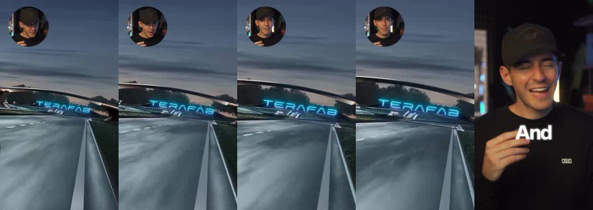

# v05_s03 · pip_broll · 3.5–4.3s (calidad 4)

- **Guion:** the TerraFab.
- **Qué se ve:** Render a pantalla completa de una carretera con un arco y el rótulo de neón «TERAFAB»; su cara en un círculo arriba a la izquierda. No se ve subtítulo.
- **Diseño:** Círculo de su cara: diámetro ≈ 21 % del ancho (~150 px), centro en x≈12 %, y≈7 %; sin borde visible. Sin subtítulo: el propio rótulo «TERAFAB» del render hace de texto
- **Efectos:** Desenfoque de movimiento propio del render; tonos azul acero
- **Animación:** Corte seco de entrada y salida (1 fotograma); el círculo aparece ya colocado (sin animación visible)
- **Por qué aquí:** Dice «the TeraFab» y el nombre se LEE dentro de la imagen: match palabra→rótulo; primera vez que el b-roll ocupa todo
