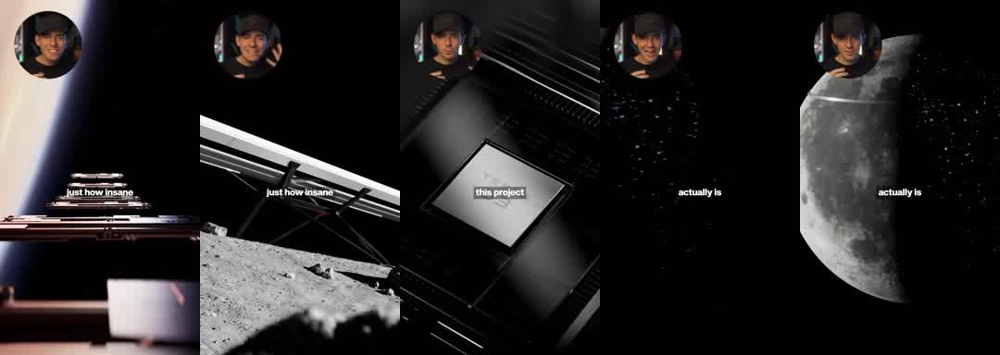

# v05_s05 · pip_broll · 5.3–8.3s (calidad 4)

- **Guion:** how insane this project actually is. This
- **Qué se ve:** Montaje rápido a pantalla completa con su cara en círculo: forma abstracta clara (5.34–5.63), superficie lunar en B/N (5.63–6.01), panel/estructura sobre la Luna (6.01–6.26), destellos rojos con glitch (6.26–6.72), macro de un chip en B/N (6.72–7.42) y la Luna en el espacio (7.42–8.30). Subtítulo pequeño centrado: «just how insane / this project / actually is».
- **Diseño:** Círculo de cara arriba-izquierda (≈21 % del ancho). Subtítulo pequeño blanco sans bold dentro de una pastilla gris oscuro semitransparente con esquinas redondeadas (aparece cuando el fondo es claro), centrado, y≈54 %; aquí el subtítulo queda en el centro geométrico de la pantalla
- **Efectos:** Blanco y negro de alto contraste en casi todos los clips; destello rojo puro (#E00000 aprox.) entre 6.26 y 6.72
- **Animación:** Cortes secos encadenados; entre 6.26 y 6.72 la imagen se tiñe de rojo y se deforma (glitch/zoom-blur) durante ~6 fotogramas antes de caer en el chip
- **Por qué aquí:** «How insane» se traduce en ritmo: el plano más rápido del video (6 imágenes en 3 s) + rojo = sobrecarga deliberada antes de la explicación calmada del mapa
