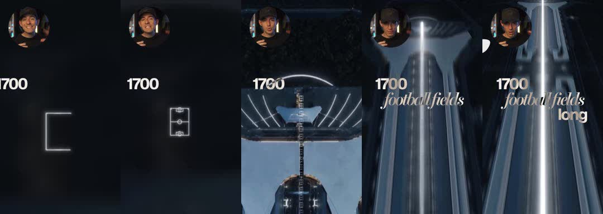

# v05_s09 · pip_broll · 13.3–15.4s (calidad 5)

- **Guion:** 1700 football fields long
- **Qué se ve:** Gráfico a pantalla completa con su cara en círculo: «1700» + icono de campo de fútbol que se dibuja; luego un render que recorre el edificio a lo largo con una línea de luz vertical; aparecen «football fields» (serif itálica) y «long».
- **Diseño:** «1700» y «long» en sans bold blanca (~56 px), «football fields» en serif itálica fina con glow; bloque alineado a la izquierda en x≈11 %, y≈38–45 %. Icono de campo en trazo blanco fino, centrado. Círculo de cara arriba-izquierda
- **Efectos:** Glow blanco en el texto y en la línea de luz; desenfoque de movimiento en el render
- **Animación:** «1700» entra deslizándose desde la izquierda (13.33–13.53); el campo se dibuja con trazo en ~0,4 s; cada palabra aparece al decirse («football» 14.0, «fields» 14.7, «long» 15.1) con fundido corto
- **Por qué aquí:** Cifra + unidad cotidiana (campos de fútbol): write-on por palabra sincronizado para que el dato se lea mientras se oye
