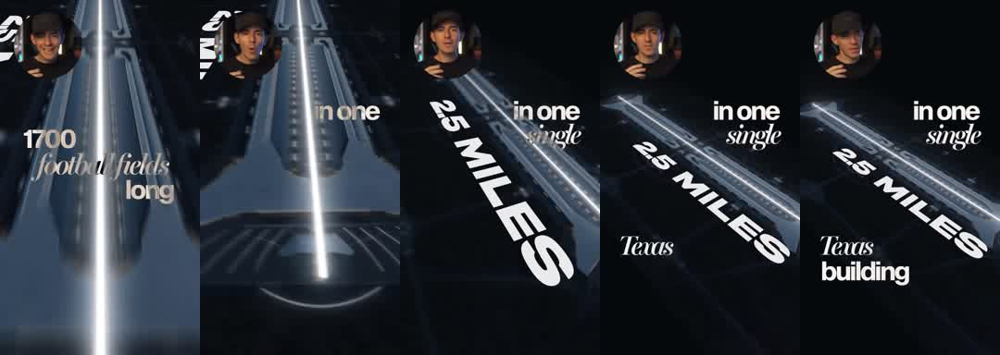

# v05_s10 · pip_broll · 15.4–17.7s (calidad 5)

- **Guion:** in one single Texas building.
- **Qué se ve:** Sigue el recorrido 3D: aparecen «in one single» (arriba derecha), «2.5 MILES» en diagonal siguiendo el edificio y «Texas building» (abajo izquierda). Cara en círculo.
- **Diseño:** «in one» sans bold + «single» serif itálica (arriba-derecha, y≈30–36 %); «2.5 MILES» mayúsculas sans extendida pesada rotada ~40° a lo largo del edificio; «Texas» serif itálica + «building» sans bold (abajo-izquierda, y≈68–76 %)
- **Efectos:** Glow en el texto; fondo casi negro azulado
- **Animación:** Texto por palabra al ritmo de la voz; «2.5 MILES» entra enorme desde la izquierda y se encoge hasta su sitio (16.0→16.5); se congela ~1 s completo antes del corte
- **Por qué aquí:** Remate del dato de tamaño: composición tipográfica completa que se puede leer como un cartel
