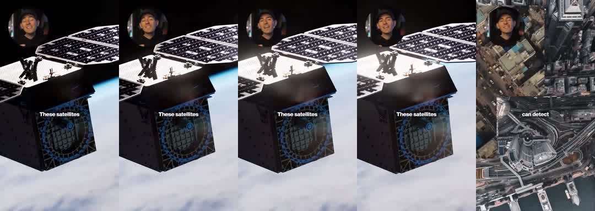

# v07_s02 · pip_broll · 3.6–4.2s (calidad 3)

- **Guion:** These satellites can
- **Qué se ve:** Render a pantalla completa de un satélite negro con paneles solares sobre nubes; su cara en círculo arriba-izquierda; subtítulo «These satellites».
- **Diseño:** Círculo de su cara arriba-izquierda: diámetro ≈22 % del ancho, centro x≈12 %, y≈7 %, sin borde. Subtítulo pequeño blanco sans bold en pastilla gris oscuro semitransparente redondeada, centrado en x e y≈54 % (centro de la pantalla)
- **Efectos:** Alto contraste blanco/negro
- **Animación:** Corte seco de entrada y salida (1 fotograma)
- **Por qué aquí:** «These satellites» → el objeto a todo tamaño; primer cambio a pantalla completa
