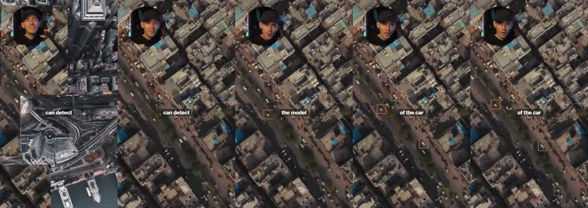

# v07_s03 · pip_broll · 4.2–6.4s (calidad 5)

- **Guion:** detect the model of the car in
- **Qué se ve:** Imagen satelital a pantalla completa: salto de zoom desde un puerto/ciudad hasta una avenida densa; aparecen recuadros naranjas y blancos sobre coches. Subtítulos «can detect», «the model», «of the car».
- **Diseño:** Círculo de su cara arriba-izquierda: diámetro ≈22 % del ancho, centro x≈12 %, y≈7 %, sin borde. Recuadros de detección cuadrados de trazo fino naranja y blanco (~6 % del ancho). Subtítulo pequeño blanco sans bold en pastilla gris oscuro semitransparente redondeada, centrado en x e y≈54 % (centro de la pantalla)
- **Efectos:** Tono cálido de imagen aérea; desenfoque de movimiento en el zoom
- **Animación:** Corte seco + zoom-blur de ~5 fotogramas al inicio; recuadros aparecen de uno en uno (≈5.0, 5.4, 5.9)
- **Por qué aquí:** «Can detect the model of the car» → la detección se dibuja sobre la imagen (prueba de la afirmación)
