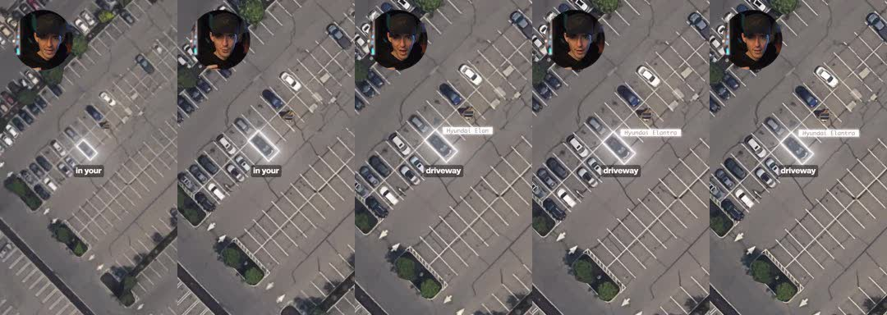

# v07_s04 · pip_broll · 6.4–7.4s (calidad 5)

- **Guion:** your driveway from
- **Qué se ve:** Aparcamiento visto desde arriba a pantalla completa: un recuadro blanco brillante marca un coche y sale una etiqueta «Hyundai Elantra». Subtítulos «in your», «driveway».
- **Diseño:** Círculo de su cara arriba-izquierda: diámetro ≈22 % del ancho, centro x≈12 %, y≈7 %, sin borde. Recuadro blanco con glow; etiqueta blanca rectangular con texto mono-espaciado oscuro pequeño. Subtítulo pequeño blanco sans bold en pastilla gris oscuro semitransparente redondeada, centrado en x e y≈54 % (centro de la pantalla)
- **Efectos:** Glow blanco en el recuadro
- **Animación:** Corte seco; recuadro se ilumina a ≈6.6 y la etiqueta sale a ≈6.9 (≈ +0,2 s tras «driveway»)
- **Por qué aquí:** Remate concreto: un modelo de coche con nombre = «esto te afecta a ti»
