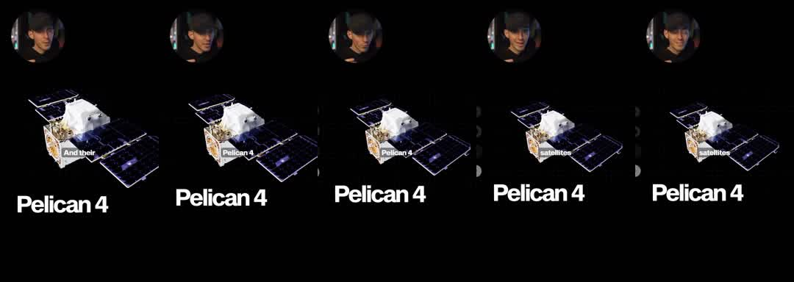

# v07_s08 · pip_broll · 10.9–12.1s (calidad 4)

- **Guion:** And their Pelican 4 satellites can
- **Qué se ve:** Pantalla completa negra con trama de puntos: render 3D del satélite despiezado y el rótulo grande «Pelican 4» abajo a la izquierda; cara en círculo; subtítulo en pastilla.
- **Diseño:** Círculo de su cara arriba-izquierda: diámetro ≈22 % del ancho, centro x≈12 %, y≈7 %, sin borde. «Pelican 4» en sans bold blanca muy grande (~80 px), alineado a la izquierda en x≈10 %, y≈69 %. Fondo negro con trama de puntos gris. Subtítulo pequeño blanco sans bold en pastilla gris oscuro semitransparente redondeada, centrado en x e y≈54 % (centro de la pantalla)
- **Efectos:** Trama de puntos tenue; líneas azul eléctrico en los paneles
- **Animación:** Corte seco; el rótulo entra desde abajo y se asienta en ~0,3 s
- **Por qué aquí:** Nombre del producto → ficha de producto (objeto + nombre)
