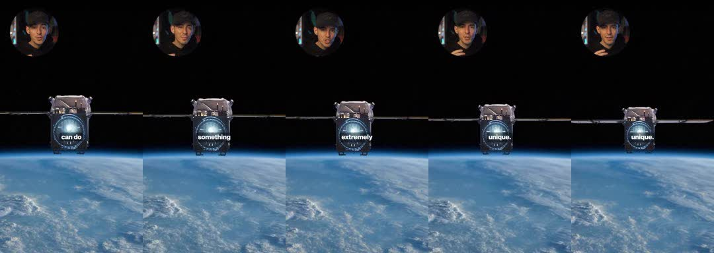

# v07_s09 · pip_broll · 12.1–13.9s (calidad 3)

- **Guion:** do something extremely unique.
- **Qué se ve:** Pantalla completa: el satélite visto de frente (lente circular azul) centrado sobre el horizonte nublado de la Tierra; subtítulos «can do», «something», «extremely», «unique.».
- **Diseño:** Círculo de su cara arriba-izquierda: diámetro ≈22 % del ancho, centro x≈12 %, y≈7 %, sin borde. Subtítulo pequeño blanco sans bold en pastilla gris oscuro semitransparente redondeada, centrado en x e y≈54 % (centro de la pantalla)
- **Efectos:** Negro del espacio arriba, nubes azuladas abajo
- **Animación:** Corte seco de entrada y salida (1 fotograma)
- **Por qué aquí:** Pausa de expectativa («something extremely unique») con imagen simétrica y quieta
