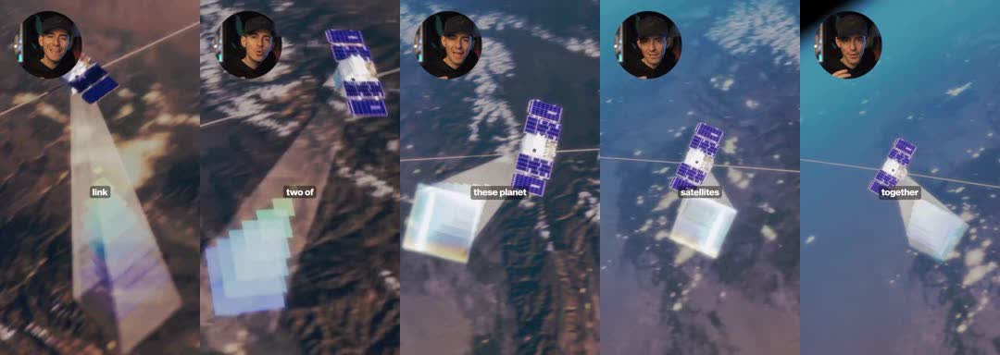

# v07_s25 · pip_broll · 41.8–44.4s (calidad 4)

- **Guion:** two of these planet satellites together.
- **Qué se ve:** Pantalla completa: animación 3D de un satélite sobre el terreno proyectando un cono de luz y una huella rectangular; una línea lo une a otro satélite. Cara en círculo; subtítulos «link», «these planet», «satellites», «together».
- **Diseño:** Círculo de su cara arriba-izquierda: diámetro ≈22 % del ancho, centro x≈12 %, y≈7 %, sin borde. Subtítulo pequeño blanco sans bold en pastilla gris oscuro semitransparente redondeada, centrado en x e y≈54 % (centro de la pantalla)
- **Efectos:** Desenfoque de movimiento al inicio; iridiscencia en la huella
- **Animación:** Corte seco; el plano arranca con barrido rápido y se estabiliza
- **Por qué aquí:** «Link two of these satellites together» → se ve el enlace
