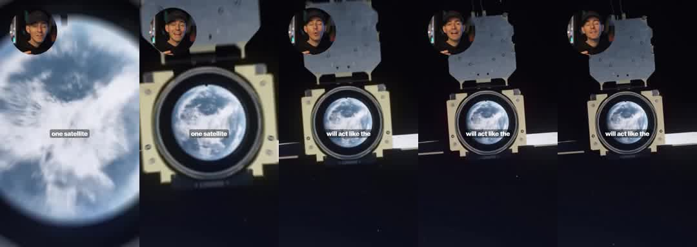

# v07_s26 · pip_broll · 44.4–45.5s (calidad 5)

- **Guion:** One satellite will act like the
- **Qué se ve:** Pantalla completa: la imagen de nubes se aleja y resulta estar dentro de la lente del satélite (reveal).
- **Diseño:** Círculo de su cara arriba-izquierda: diámetro ≈22 % del ancho, centro x≈12 %, y≈7 %, sin borde. Subtítulo pequeño blanco sans bold en pastilla gris oscuro semitransparente redondeada, centrado en x e y≈54 % (centro de la pantalla)
- **Efectos:** Viñeta circular de la lente
- **Animación:** Zoom-out de ~5 fotogramas (44.4–44.7) y luego quieto
- **Por qué aquí:** «One satellite will act like the wide-angle camera» → la lente literal
