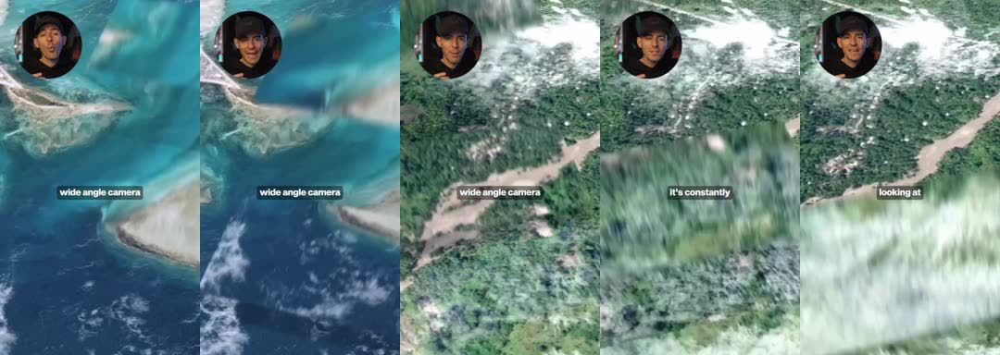

# v07_s27 · pip_broll · 45.5–48.1s (calidad 4)

- **Guion:** wide -angle camera. It's constantly looking at strips
- **Qué se ve:** Pantalla completa: imágenes aéreas que pasan muy rápido: costa turquesa (45.55–46.30) y selva con río en barrido a saltos (46.30–48.09).
- **Diseño:** Círculo de su cara arriba-izquierda: diámetro ≈22 % del ancho, centro x≈12 %, y≈7 %, sin borde. Subtítulo pequeño blanco sans bold en pastilla gris oscuro semitransparente redondeada, centrado en x e y≈54 % (centro de la pantalla)
- **Efectos:** Desenfoque de movimiento fuerte
- **Animación:** Corte seco; barrido escalonado tipo escáner
- **Por qué aquí:** «Constantly looking at…» → sensación de escaneo continuo
