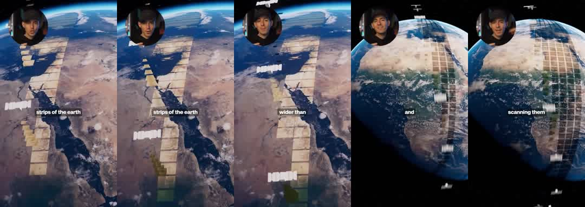

# v07_s28 · pip_broll · 48.1–51.3s (calidad 4)

- **Guion:** of the Earth, wider than most cities, and scanning them
- **Qué se ve:** Pantalla completa: la Tierra desde la órbita con franjas de teselas que se van colocando (48.09–50.26) y el globo cubierto de franjas (50.26–51.26).
- **Diseño:** Círculo de su cara arriba-izquierda: diámetro ≈22 % del ancho, centro x≈12 %, y≈7 %, sin borde. Subtítulo pequeño blanco sans bold en pastilla gris oscuro semitransparente redondeada, centrado en x e y≈54 % (centro de la pantalla)
- **Efectos:** Set oscuro con luces cian y ámbar desenfocadas; sin textura añadida
- **Animación:** Corte seco; teselas aparecen en cadena
- **Por qué aquí:** «Strips of the Earth wider than most cities» → franjas literales
