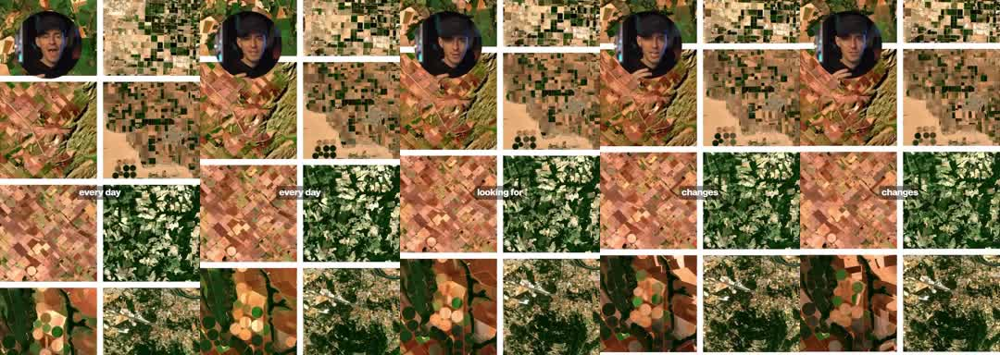

# v07_s29 · pip_broll · 51.3–53.0s (calidad 3)

- **Guion:** every day looking for changes.
- **Qué se ve:** Pantalla completa: mosaico de teselas agrícolas con separaciones blancas, desplazándose.
- **Diseño:** Círculo de su cara arriba-izquierda: diámetro ≈22 % del ancho, centro x≈12 %, y≈7 %, sin borde. Subtítulo pequeño blanco sans bold en pastilla gris oscuro semitransparente redondeada, centrado en x e y≈54 % (centro de la pantalla)
- **Efectos:** Set oscuro con luces cian y ámbar desenfocadas; sin textura añadida
- **Animación:** Corte seco de entrada y salida (1 fotograma)
- **Por qué aquí:** «Every day looking for changes» → muchas teselas = revisión diaria
