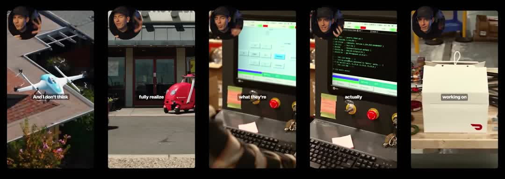

# v08_s02 · pip_broll · 3.4–6.6s (calidad 4)

- **Guion:** And I don't think people fully realize what they're actually working on under
- **Qué se ve:** Tarjeta redondeada a pantalla completa con su cara en círculo en la esquina: dron sobre un tejado (3.42–4.05), robots rojos «Dot» frente a una tienda (4.05–5.01), puesto de control con pantalla de código (5.01–5.92) y caja blanca DoorDash en un banco de trabajo (5.92–6.59). Subtítulos «And I don't think», «people», «fully realize», «what they're», «actually», «working on».
- **Diseño:** Tarjeta vertical de esquinas redondeadas (x≈7–93 %, y≈6–94 %, radio ≈2 % del ancho) sobre negro; círculo de su cara de diámetro ≈23 % del ancho montado sobre la esquina superior izquierda de la tarjeta (centro x≈12 %, y≈12 %), sin borde. Subtítulo pequeño blanco sans bold, centrado en x e y≈54 %, con pastilla gris semitransparente redondeada cuando el fondo es claro
- **Efectos:** Margen negro alrededor de la tarjeta
- **Animación:** Corte seco a la tarjeta (aparece a tamaño final); cortes secos internos
- **Por qué aquí:** «I don't think people fully realize what they're working on» → 4 vistazos de «lo que hay detrás» (dron, robots, código, hardware)
