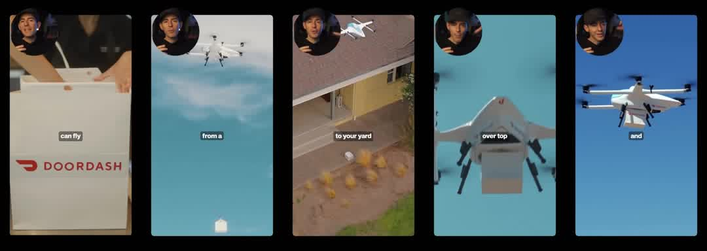

# v08_s07 · pip_broll · 14.9–19.4s (calidad 4)

- **Guion:** This thing can fly straight from a restaurant to your yard, over top of all the traffic and
- **Qué se ve:** Tarjeta redondeada con cara en círculo: bolsa blanca DoorDash en primer plano (14.89–15.85), dron bajando un paquete (15.85–16.64), jardín visto desde arriba con el paquete descendiendo (16.64–17.60), parte inferior del dron (17.60–18.44) y dron en el cielo (18.44–19.35). Subtítulos «This thing», «can fly», «straight», «restaurant», «to your yard», «over top», «traffic», «and».
- **Diseño:** Tarjeta vertical de esquinas redondeadas (x≈7–93 %, y≈6–94 %, radio ≈2 % del ancho) sobre negro; círculo de su cara de diámetro ≈23 % del ancho montado sobre la esquina superior izquierda de la tarjeta (centro x≈12 %, y≈12 %), sin borde. Subtítulo pequeño blanco sans bold, centrado en x e y≈54 %, con pastilla gris semitransparente redondeada cuando el fondo es claro
- **Efectos:** Margen negro
- **Animación:** Corte seco de entrada y salida (1 fotograma)
- **Por qué aquí:** «Fly straight from a restaurant to your yard» → secuencia en orden (bolsa → vuelo → jardín)
