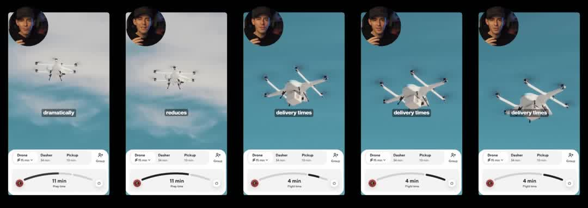

# v08_s08 · pip_broll · 19.4–21.3s (calidad 5)

- **Guion:** dramatically reduces delivery times. But
- **Qué se ve:** Tarjeta con cara en círculo: dron en el cielo y, en la parte inferior, un panel blanco de la app con pestañas «Drone 15 min · Dasher 34 min · Pickup 10 min · Group» y un arco de progreso que pasa de «11 min Prep time» a «4 min Flight time». Subtítulos «dramatically», «reduces», «delivery times».
- **Diseño:** Tarjeta vertical de esquinas redondeadas (x≈7–93 %, y≈6–94 %, radio ≈2 % del ancho) sobre negro; círculo de su cara de diámetro ≈23 % del ancho montado sobre la esquina superior izquierda de la tarjeta (centro x≈12 %, y≈12 %), sin borde. Panel blanco redondeado (≈27 % del alto de la tarjeta) con tipografía sans oscura; arco negro que se rellena. Subtítulo pequeño blanco sans bold, centrado en x e y≈54 %, con pastilla gris semitransparente redondeada cuando el fondo es claro
- **Efectos:** Sombra suave bajo el panel
- **Animación:** El panel está presente desde el corte; el arco avanza y el rótulo cambia de «11 min Prep time» a «4 min Flight time» (≈19.9)
- **Por qué aquí:** Dato comparativo sin decir cifras: la interfaz enseña Drone 15 min vs Dasher 34 min mientras dice «dramatically reduces delivery times»
