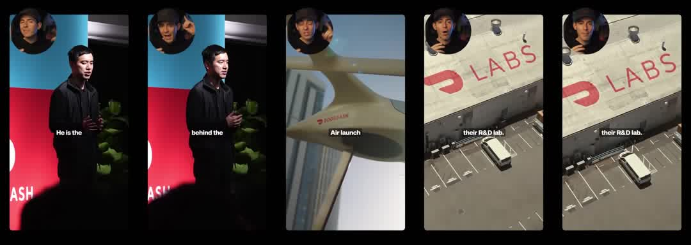

# v08_s14 · pip_broll · 31.5–35.0s (calidad 4)

- **Guion:** He is the mastermind behind the air launch and he runs their R &D lab.
- **Qué se ve:** Tarjeta con cara en círculo: Stanley en un escenario rojo/azul (31.49–32.74), parte inferior del dron (32.74–33.33) y vista aérea de un edificio con «LABS» y el logo en el tejado (33.33–34.99). Subtítulos «He is the», «mastermind», «behind the», «Air launch», «and he runs», «their R&D lab.».
- **Diseño:** Tarjeta vertical de esquinas redondeadas (x≈7–93 %, y≈6–94 %, radio ≈2 % del ancho) sobre negro; círculo de su cara de diámetro ≈23 % del ancho montado sobre la esquina superior izquierda de la tarjeta (centro x≈12 %, y≈12 %), sin borde. Subtítulo pequeño blanco sans bold, centrado en x e y≈54 %, con pastilla gris semitransparente redondeada cuando el fondo es claro
- **Efectos:** Margen negro
- **Animación:** Corte seco de entrada y salida (1 fotograma)
- **Por qué aquí:** Cada rol tiene su imagen: «mastermind» → él, «Air launch» → dron, «R&D lab» → edificio LABS
