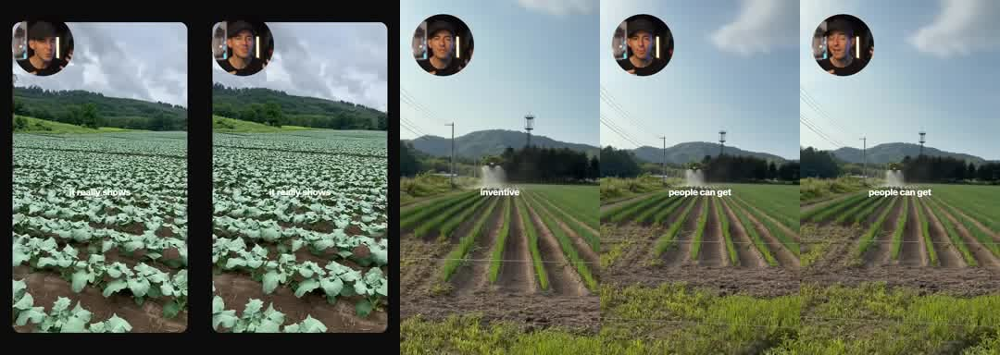

# v09_s30 · pip_broll · 65.1–67.7s (calidad 4)

- **Guion:** it really shows how inventive people can get when
- **Qué se ve:** B-roll a pantalla completa (campo de coles en tarjeta; luego dron fumigando a sangre) con la cara de Kallaway en un círculo arriba-izquierda.
- **Diseño:** Material a pantalla completa (100 %) con su cara en un círculo arriba-izquierda (diámetro ≈32–34 % del ancho, centro x≈20 %, y≈7–10 %, sin borde visible). Subtítulo: sans geométrica bold blanca, minúsculas con puntuación, ≈30 px de alto de letra sobre 720 px de ancho, centrado en x, 1–3 palabras, centrado en y≈51–54 %, con caja gris translúcida cuando el fondo es claro o es interfaz.
- **Efectos:** Círculo de cara recortado limpio (sin borde ni sombra apreciable). Material de fondo sin grado añadido.
- **Animación:** Entra por corte seco; el círculo de cara aparece ya colocado (sin animación apreciable a 15 fps) y permanece fijo mientras el fondo cambia por corte.
- **Por qué aquí:** Moraleja ('how inventive people can get'): paisajes amplios para respirar, sin perder la voz/cara.
