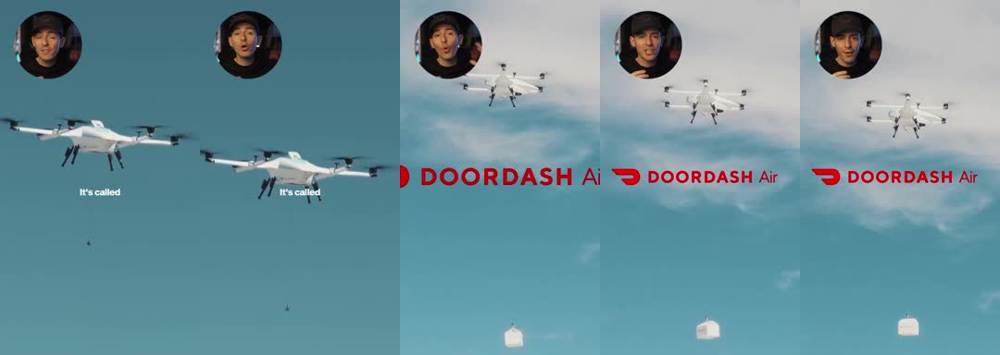

# v11_s02 · pip_broll · 3.2–4.8s (calidad 5)

- **Guion:** It's called DoorDash Air.
- **Qué se ve:** Dron a pantalla completa con su cara en círculo arriba-izquierda; en 3.92 otro plano del dron y el logo 'DOORDASH Air' rojo se revela de izquierda a derecha en el centro.
- **Diseño:** Pantalla completa (100 %) con cara en círculo arriba-izquierda (diámetro ≈34 % del ancho, centro x≈20 %, y≈7 %). Logo oficial 'DOORDASH Air' en rojo DoorDash (≈#EB1700), ≈92 % del ancho, centrado en y≈50 %. Subtítulo pequeño 'It's called' centrado en y≈54 % (desaparece al entrar el logo).
- **Efectos:** Círculo de cara recortado limpio (sin borde ni sombra apreciable). Material de fondo sin grado añadido.
- **Animación:** Corte seco a pantalla completa con el círculo ya puesto; en 3.92 corte interno y el logo se revela por barrido izquierda→derecha en ≈0.3 s (5 fotogramas), sincronizado con 'DoorDash Air' (3.64–4.40). Sale por corte seco.
- **Por qué aquí:** Nombre del producto = logo oficial a toda pantalla; el PiP mantiene la cara sin partir la imagen del cielo.
