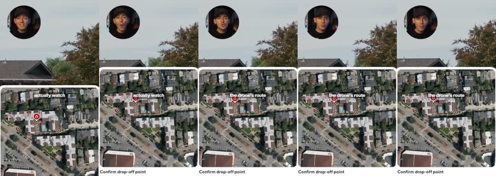

# v11_s07 · pip_broll · 17.2–19.0s (calidad 5)

- **Guion:** actually watch the drones route via
- **Qué se ve:** Pantalla completa con cara en círculo: cielo/casa arriba y una tarjeta de mapa satelital con pines 'Confirm drop-off point' que sube desde abajo hasta ocupar la mitad inferior.
- **Diseño:** Pantalla completa con cara en círculo arriba-izquierda. Tarjeta de UI blanca con esquinas redondeadas (radio grande) a todo el ancho, de y≈38 % al borde inferior, con mapa satelital y texto 'Confirm drop-off point' (sans negra ≈26 px) al pie. Subtítulo pequeño blanco sobre el mapa en y≈54 %.
- **Efectos:** Círculo de cara recortado limpio (sin borde ni sombra apreciable). Material de fondo sin grado añadido.
- **Animación:** Corte seco; la tarjeta del mapa sube desde el borde inferior en ≈0.35 s (5 fotogramas, ease-out) y se queda. Sale por corte.
- **Por qué aquí:** 'you can actually watch the drone's route': la interfaz real ocupa el sitio donde estaba él, y él pasa al círculo → invierte el split.
