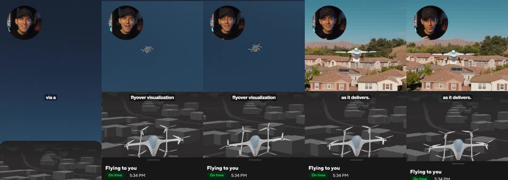

# v11_s08 · pip_broll · 19.0–21.8s (calidad 5)

- **Guion:** a flyover visualization as it delivers.
- **Qué se ve:** Pantalla completa con cara en círculo: arriba dron en cielo azul oscuro (luego urbanización), abajo panel oscuro 3D de la app con el dron en alambre y 'Flying to you · On time · 5:34 PM'.
- **Diseño:** Pantalla completa con cara en círculo arriba-izquierda; split interno ≈50/50 entre vídeo real (arriba) y UI oscura 3D de la app (abajo, texto 'Flying to you' sans blanca bold ≈22 px, chip verde 'On time'). Subtítulo pequeño blanco con caja gris translúcida sobre la unión (y≈54 %).
- **Efectos:** Círculo de cara recortado limpio (sin borde ni sombra apreciable). Material de fondo sin grado añadido.
- **Animación:** El panel oscuro sube desde abajo en ≈0.4 s; después cortes secos en la mitad superior.
- **Por qué aquí:** 'via a flyover visualization': dron real arriba / su gemelo digital abajo = comparación directa.
