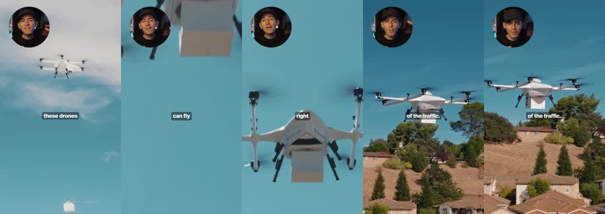

# v11_s10 · pip_broll · 22.6–25.9s (calidad 4)

- **Guion:** these drones can fly right over top of the traffic.
- **Qué se ve:** Tres planos del dron a pantalla completa (lejano entre nubes, contrapicado bajo el dron, sobre una colina con casas) con la cara en círculo.
- **Diseño:** Material a pantalla completa (100 %) con su cara en un círculo arriba-izquierda (diámetro ≈32–34 % del ancho, centro x≈20 %, y≈7–10 %, sin borde visible). Subtítulo: sans geométrica bold blanca, minúsculas con puntuación, ≈30 px de alto de letra sobre 720 px de ancho, centrado en x, 1–3 palabras, centrado en y≈51–54 %, con caja gris translúcida cuando el fondo es claro o es interfaz.
- **Efectos:** Círculo de cara recortado limpio (sin borde ni sombra apreciable). Material de fondo sin grado añadido.
- **Animación:** Entra por corte seco; el círculo de cara aparece ya colocado (sin animación apreciable a 15 fps) y permanece fijo mientras el fondo cambia por corte.
- **Por qué aquí:** 'fly right over top of the traffic': la altura se siente mejor a pantalla completa que en media pantalla.
