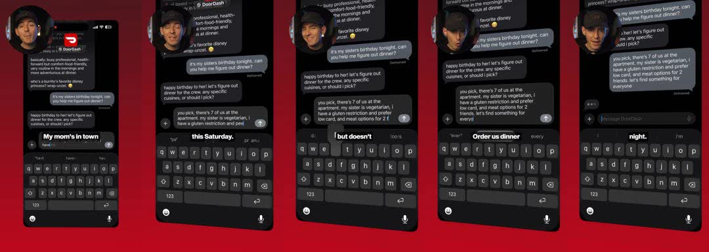

# v11_s22 · pip_broll · 51.1–56.5s (calidad 5)

- **Guion:** my mom's in town this Saturday, she loves pasta but doesn't like seafood, order us dinner for Saturday night.
- **Qué se ve:** Fondo degradado rojo; móvil 3D inclinado con el chat de DoorDash y el teclado, que se acerca; cara en círculo arriba-izquierda. El subtítulo va colocado EN la barra de autocompletar del teclado del móvil y dicta el mensaje: 'My mom's in town / this Saturday. / She loves pasta / but doesn't / like seafood. / Order us dinner / for Saturday / night.'
- **Diseño:** Pantalla completa: fondo degradado rojo DoorDash (≈#B0101C → #7A0A12 hacia arriba) con móvil negro en perspectiva 3D (ligera rotación), ≈70 %→95 % del ancho. Cara en círculo arriba-izquierda (≈30 % del ancho) solapando el móvil. Subtítulo sans bold blanca ≈30 px colocado exactamente sobre la franja de sugerencias del teclado (y≈54 %), flanqueado por las sugerencias grises reales (“an” / any).
- **Efectos:** Fondo con degradado y viñeta roja; móvil con sombra y reflejo de borde; teclas que se iluminan. Sin grano.
- **Animación:** Corte seco; el móvil hace zoom-in continuo ≈1.6 s y luego deriva lento. El subtítulo cambia cada 2–3 palabras como si fuese la predicción del teclado; las teclas se pulsan y la burbuja se envía en ≈55.3. Plano único.
- **Por qué aquí:** El ejemplo de prompt se 'teclea' ante el espectador: fundir el subtítulo con el teclado hace que la frase hablada parezca el mensaje real.
