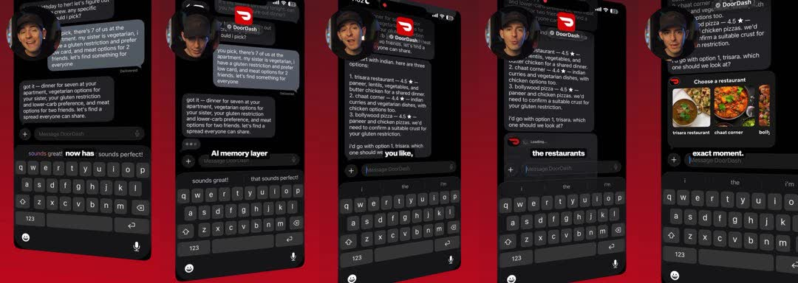

# v11_s23 · pip_broll · 56.5–66.6s (calidad 4)

- **Guion:** DoorDash now has a personalized AI memory layer that knows exactly where you live and what you like based on previous orders, as well as all the restaurants available to you in that exact moment.
- **Qué se ve:** Mismo plano continuo del móvil sobre rojo (10 s más): llegan las respuestas de DoorDash, lista de 3 restaurantes, y un carrusel 'Choose a restaurant' con fotos; el subtítulo sigue en la barra del teclado.
- **Diseño:** Igual que la escena anterior (móvil 3D sobre degradado rojo, cara en círculo, subtítulo en la barra de sugerencias del teclado).
- **Efectos:** Círculo de cara recortado limpio (sin borde ni sombra apreciable). Material de fondo sin grado añadido.
- **Animación:** Sin cortes: el móvil deriva y el chat sube con cada mensaje (≈1 cambio cada 3–4 s). 15.5 s de plano único sumando la escena anterior: el más largo del vídeo.
- **Por qué aquí:** 'personalized AI memory layer that knows exactly where you live and what you like': la respuesta de la IA demuestra la memoria; se deja respirar porque el contenido es el chat.
