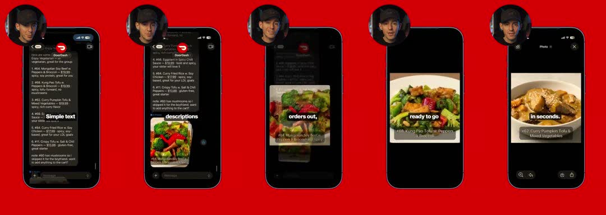

# v11_s27 · pip_broll · 74.7–78.1s (calidad 4)

- **Guion:** Simple text descriptions in, orders out, ready to go in seconds.
- **Qué se ve:** Fondo rojo plano; móvil de frente con el chat (lista numerada de platos) y fotos de platos que entran como tarjetas; cara en círculo solapando la esquina del móvil.
- **Diseño:** Pantalla completa: fondo rojo plano saturado (≈#E00000), móvil negro frontal centrado (≈62 % del ancho, y≈8–92 %). Cara en círculo arriba-izquierda (≈34 %) solapando la esquina superior del móvil. Subtítulo sans bold con caja translúcida en y≈54 %, sobre la pantalla del móvil.
- **Efectos:** Rojo plano sin degradado ni textura; móvil con borde brillante fino.
- **Animación:** Corte seco; dentro, las fotos entran con slide/escala y se pasan como carrusel (≈0.5 s cada una).
- **Por qué aquí:** 'Simple text descriptions in, orders out, ready to go in seconds': resumen visual del flujo sobre el color de marca.
