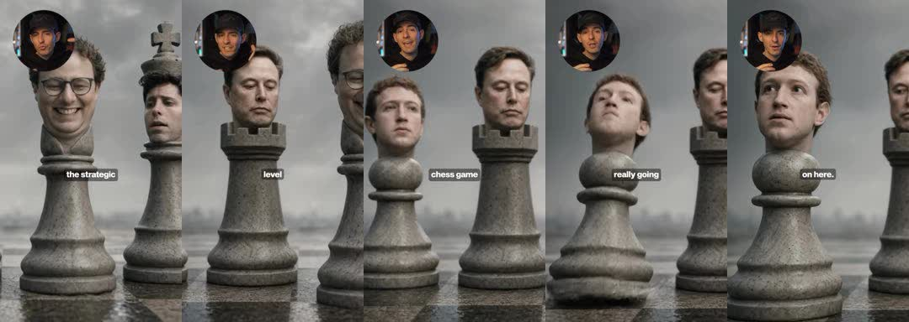

# v14_s09 · pip_broll · 10.5–13.7s (calidad 5)

- **Guion:** the strategic level chess game that is really going on here.
- **Qué se ve:** Imagen a pantalla completa de piezas de ajedrez de piedra con cabezas de directivos tecnológicos (un hombre con gafas, uno sobre un rey, uno sobre una torre, uno sobre un peón), cielo nublado. Su cara en un círculo arriba a la izquierda. Subtítulos «the strategic», «level», «chess game», «that is», «really going», «on here.».
- **Diseño:** Imagen a pantalla completa con su cara en un círculo arriba a la izquierda: diámetro ~240 px (33 % del ancho), centro en x≈170, y≈160 px, sin borde visible. Subtítulo: sans bold blanca (tipo Inter/Helvetica Now Bold) ~30 px de alto de fuente sobre 720 px de ancho, 1–3 palabras, centrado en x, sombra negra suave. Subtítulo en y≈693 px con caja oscura semitransparente.
- **Efectos:** Imagen generada de look fotorrealista gris/desaturado (piedra, niebla).
- **Animación:** La imagen tiene paneo lento hacia la derecha (paralaje); el círculo queda fijo. Corte seco.
- **Por qué aquí:** Metáfora literal de «partida de ajedrez estratégica»; el círculo mantiene su presencia mientras la imagen ocupa todo.
